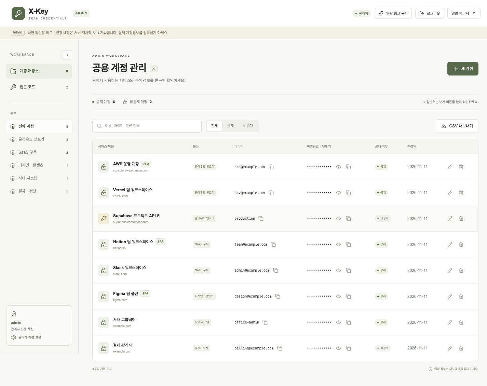
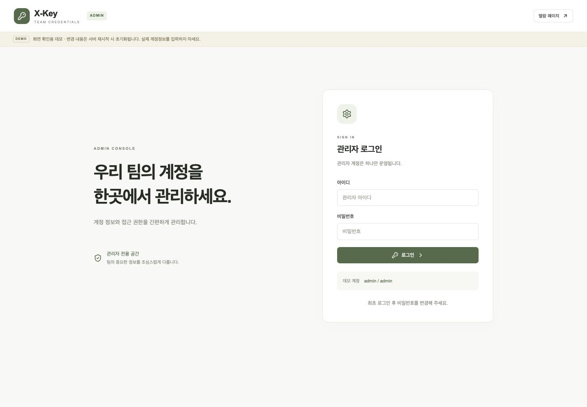
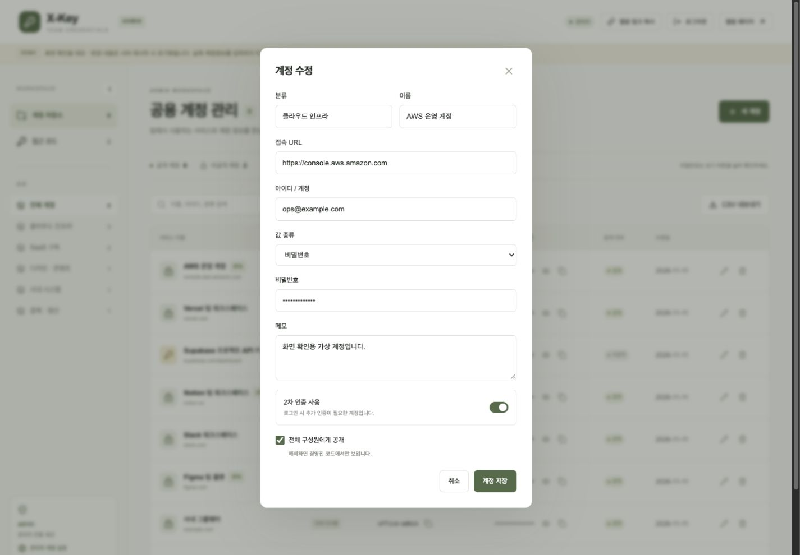
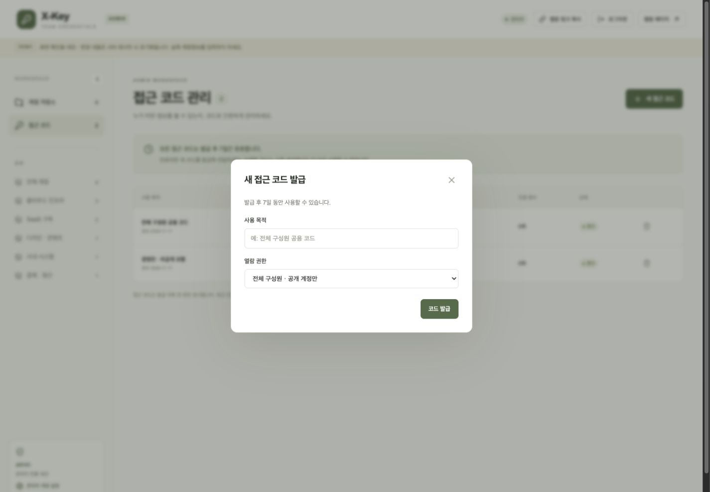
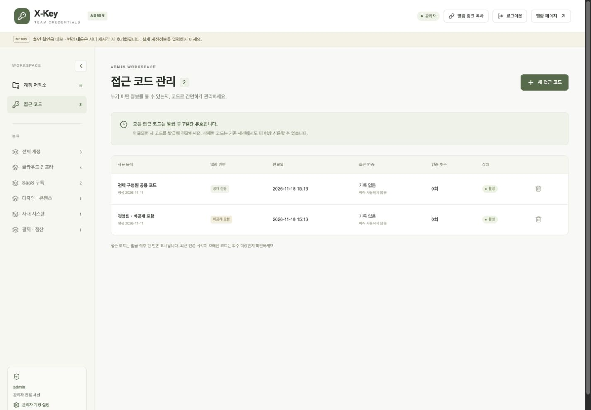
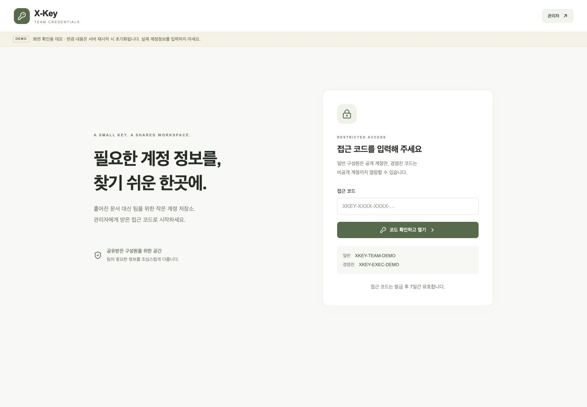
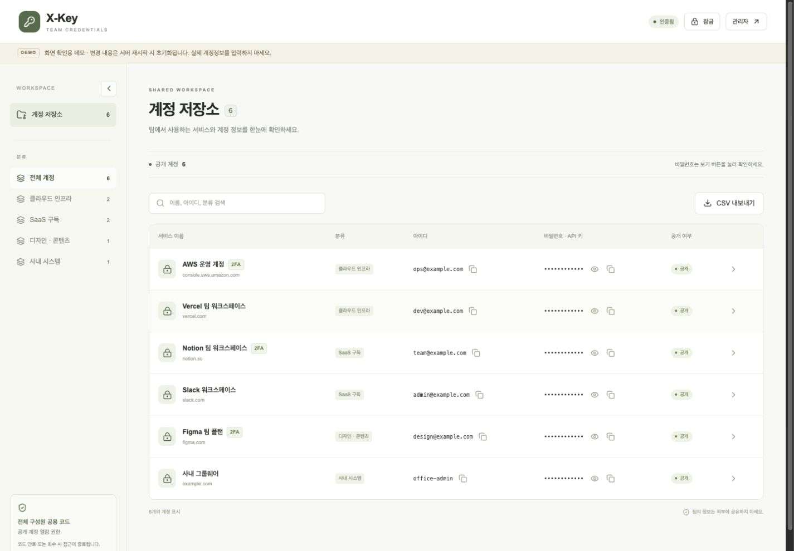
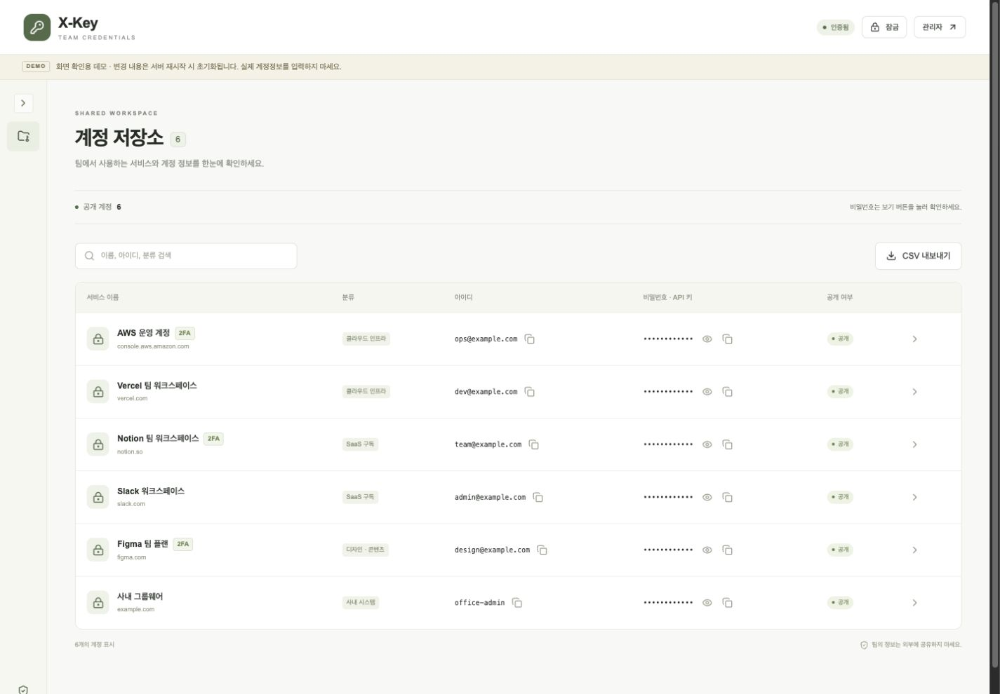
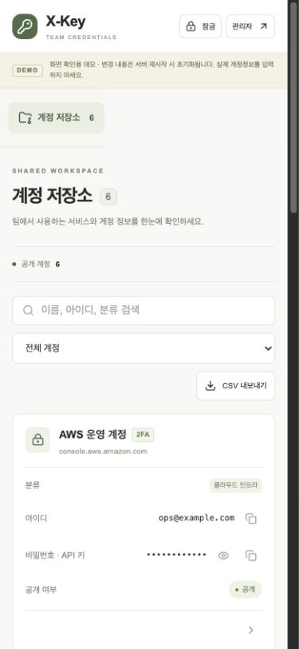

<div align="center">
  
  <h1>X-Key</h1>
  <p><strong>문서와 엑셀에 흩어진 팀 계정 정보를, 한곳에.</strong></p>
  <p>계정 저장 · 접근 코드 공유 · 2FA 표시 · CSV 내보내기</p>
  <p><a href="#먼저-화면만-체험하기">데모 실행</a> · <a href="#실제-회사에서-사용하기">설치 가이드</a> · <a href="#설치-후-사용법">사용법</a> · <a href="#문제가-생겼을-때">문제 해결</a></p>
</div>



회사에서 함께 사용하는 서비스의 URL, 아이디, 비밀번호와 API 키를 정리하는 작은 도구입니다.
관리자는 계정을 등록하고, 구성원은 전달받은 링크와 접근 코드로 필요한 정보를 찾습니다.

**이 저장소를 설치하는 사람마다 자신의 Supabase DB와 웹 호스팅을 연결해 사용합니다.**
제작자의 DB나 실제 회사 계정이 함께 제공되는 방식은 아닙니다.

> 모든 스크린샷은 가상 계정으로 촬영한 데모입니다. `example.com` 이메일과 화면의 데모 코드는 실제 업무용 정보가 아닙니다.

## 어떤 기능이 있나요?

| 기능 | 할 수 있는 일 |
| --- | --- |
| 계정 저장소 | 분류, 이름, URL, 아이디, 비밀번호/API 키, 메모 등록·수정·삭제 |
| 두 가지 공유 권한 | 구성원 코드는 공개 계정만, 경영진 코드는 비공개 계정까지 열람 |
| 7일 접근 코드 | 발급 시점부터 7일간 사용, 최근 인증 시각·횟수 확인, 코드 회수 |
| 2FA 표시 | 추가 인증이 필요한 계정에 작은 `2FA` 텍스트 배지 표시 |
| 검색과 CSV | 검색·분류·공개 여부로 필터하고 현재 목록을 CSV로 저장 |
| 화면 크기 대응 | 접히는 사이드바, 휴대폰에서 읽기 편한 카드 목록 |

`공개`는 **유효한 구성원 코드로 볼 수 있다는 뜻**입니다. 코드 없이 인터넷에 공개된다는 뜻은 아닙니다.
2FA 배지는 해당 서비스의 추가 인증 여부를 기록하는 표시입니다. OTP 생성이나 인증 우회 기능은 없습니다.

## 먼저 화면만 체험하기

DB나 호스팅을 준비하기 전에 로컬에서 화면부터 확인할 수 있습니다.
**Node.js 22 이상**, npm, Git이 필요합니다.

```bash
git clone https://github.com/xierrajeon/X-Key.git
cd X-Key
npm ci
npm run dev
```

터미널에 표시된 주소를 엽니다. 기본 주소는 [http://localhost:3000](http://localhost:3000)입니다.
포트가 사용 중이면 터미널에 표시된 다른 포트를 사용하세요.

| 데모 진입 | 값 |
| --- | --- |
| 관리자 `/admin` | 아이디 `admin` / 비밀번호 `admin` |
| 구성원 `/` | 코드 `XKEY-TEAM-DEMO` |
| 경영진 `/` | 코드 `XKEY-EXEC-DEMO` |

- 환경변수가 없는 개발 환경에서만 메모리 데모로 동작합니다.
- 관리자 첫 로그인 시 새 비밀번호를 설정해야 합니다. 데모 변경 내용은 서버 재시작 시 초기화됩니다.
- **실제 회사 계정정보는 데모에 입력하지 마세요.** 실제 사용은 아래 DB 연결까지 완료한 뒤 시작하세요.
- 이미 `.env.local`로 DB를 연결했다면, 데모 체험은 별도 체크아웃에서 진행하세요.

## 실제 회사에서 사용하기

### 전체 순서

**① 내 저장소 준비 → ② Supabase DB 생성 → ③ SQL 실행 → ④ 환경변수 설정 → ⑤ Vercel 배포 → ⑥ 최초 관리자 설정**

| 준비물 | 용도 |
| --- | --- |
| 내 GitHub 저장소 | 이 프로젝트를 Fork해 코드 보관·업데이트 |
| Supabase 프로젝트 | 계정정보, 접근 코드, 로그인 세션 저장 |
| Vercel 프로젝트 | 웹 화면과 Next.js 서버 API 호스팅 |

별도 VM을 운영할 필요는 없습니다. Vercel 외에도 **Next.js 서버 실행을 지원하는 호스팅**을 사용할 수 있습니다.
GitHub Pages 같은 정적 파일 전용 호스팅에는 이 프로젝트를 그대로 올릴 수 없습니다.

### 1. 내 GitHub 저장소 준비

이 저장소 오른쪽 위의 **Fork**로 본인 계정에 복사합니다.
직접 수정할 예정이라면 내 Fork를 로컬로 내려받습니다.

```bash
git clone https://github.com/YOUR_GITHUB_ID/X-Key.git
cd X-Key
npm ci
```

이후 Vercel에는 **본인이 Fork한 저장소**를 연결합니다.

### 2. Supabase 프로젝트 생성

[Supabase Dashboard](https://supabase.com/dashboard)에서 **New project**를 선택합니다.

| 항목 | 설정 |
| --- | --- |
| Project name | 원하는 이름. 예: `X-Key` |
| Database password | 강한 비밀번호를 생성하고 별도 보관 |
| Region | 사용하는 지역과 가까운 곳. 한국 사용자는 서울 선택 가능 여부 확인 |
| Enable Data API | 켜기 |
| Automatically expose new tables | 끄기 |
| Enable automatic RLS | 켜기 |

프로젝트 생성 후 아래 두 값을 확인합니다.

- **Project URL**: `https://YOUR_PROJECT.supabase.co` 형태의 프로젝트 주소
- **Secret key**: **Settings → API Keys**에서 확인하는 `sb_secret_...` 형태의 서버용 키

이 프로젝트는 서버에서 DB에 접근하므로 Publishable key는 사용하지 않습니다.
설정 이름 `SUPABASE_SERVICE_ROLE_KEY`에는 새 **Secret key**를 넣으면 됩니다. 기존 `service_role` 키도 지원합니다.
Database password는 앱 관리자 비밀번호와 별개이며, 현재 앱 환경변수에는 입력하지 않습니다.

[Supabase API 키 공식 안내](https://supabase.com/docs/guides/getting-started/api-keys)

### 3. SQL로 테이블과 함수 만들기

Supabase 왼쪽 메뉴의 **SQL Editor → New query**에서 다음 파일 내용을 **순서대로** 실행합니다.

| 순서 | 파일 | 내용 |
| --- | --- | --- |
| 1 | [001_vault.sql](supabase/migrations/001_vault.sql) | 테이블, 인증 함수, 접근 권한, 초기 관리자 생성 |
| 2 | [002_account_two_factor.sql](supabase/migrations/002_account_two_factor.sql) | 계정별 2FA 사용 여부 필드 추가 |

각 파일의 전체 내용을 붙여넣고 **Run**을 누릅니다. 오류 없이 `Success`가 표시되면 다음 파일로 넘어갑니다.

완료하면 다음 테이블 5개가 생성됩니다.

```text
xkey_admin       관리자 계정
xkey_accounts    공유할 서비스 계정
xkey_codes       접근 코드와 인증 기록
xkey_sessions    로그인 세션
xkey_attempts    인증 시도 제한
```

**새로 설치할 때만 `001`부터 실행합니다.** 기존 설치를 업데이트할 때는 아직 실행하지 않은 SQL만 추가로 적용하세요.
파일이 저장소에 있다는 것만으로 운영 DB에 자동 실행되지는 않습니다.

### 4. 환경변수와 암호화 키 준비

로컬 프로젝트에서 예제 파일을 복사합니다.

```bash
cp .env.example .env.local
```

Windows PowerShell에서는 `Copy-Item .env.example .env.local`을 사용하면 됩니다.

비밀번호/API 키 저장에 사용할 암호화 키를 생성합니다. 아래 명령은 **64자리 랜덤 hex 문자열**을 출력합니다.

```bash
node -e "console.log(require('node:crypto').randomBytes(32).toString('hex'))"
```

출력값을 `VAULT_ENCRYPTION_KEY`에 넣고, 다른 값도 채웁니다.

```dotenv
# 로컬 실행 주소. 배포 후 실제 웹 주소로 바꿉니다.
APP_URL=http://localhost:3000

# 2단계에서 확인한 Supabase 프로젝트 URL과 Secret key
SUPABASE_URL=https://YOUR_PROJECT.supabase.co
SUPABASE_SERVICE_ROLE_KEY=sb_secret_YOUR_SECRET_KEY

# 위 명령으로 생성한 64자리 값을 입력
VAULT_ENCRYPTION_KEY=YOUR_GENERATED_64_CHARACTER_HEX_KEY
```

| 변수 | 넣을 값 | 어디에 쓰나요? |
| --- | --- | --- |
| `APP_URL` | **내 웹사이트 주소** | 열람 링크 복사, 운영 요청 출처 검사 |
| `SUPABASE_URL` | **내 Supabase 주소** | DB API 연결 |
| `SUPABASE_SERVICE_ROLE_KEY` | **Supabase Secret key** | 서버 전용 DB 접근 |
| `VAULT_ENCRYPTION_KEY` | **직접 생성한 암호화 키** | 비밀번호/API 키 암호화·복호화 |

`APP_URL`과 `SUPABASE_URL`은 서로 다른 주소입니다.
`APP_URL`에는 `/admin` 같은 경로를 붙이지 않습니다.

> `.env.local`은 Git에 올리지 않습니다. Secret key와 암호화 키에 `NEXT_PUBLIC_` 접두어를 붙이지 마세요.
> **암호화 키는 안전하게 별도 보관하세요.** 계정정보를 저장한 뒤 키를 잃어버리거나 교체하면 기존 비밀번호/API 키를 읽을 수 없습니다. 로컬과 운영에서 같은 DB를 쓴다면 같은 암호화 키를 사용해야 합니다.

원하면 이 단계에서 `npm run dev`로 DB 연결을 먼저 확인할 수 있습니다.
로컬 서버 주소가 `http://localhost:3001`처럼 달라지면 로컬의 `APP_URL`도 맞춰 주세요.
환경변수를 수정한 뒤에는 개발 서버를 재시작합니다.

### 5. Vercel에 배포하고 웹 주소 설정

1. [Vercel](https://vercel.com)에 로그인합니다.
2. **Add New → Project**에서 본인이 Fork한 GitHub 저장소를 Import합니다.
3. Framework Preset은 **Next.js**, Root Directory는 저장소 루트를 사용합니다. npm 설치·빌드 설정은 기본값으로 둡니다.
4. Environment Variables에 `SUPABASE_URL`, `SUPABASE_SERVICE_ROLE_KEY`, `VAULT_ENCRYPTION_KEY`를 **Production** 대상으로 등록합니다. 로컬 파일의 값과 동일하게 입력합니다.
5. **Deploy**를 눌러 최초 배포를 마칩니다.
6. 발급된 운영 주소를 확인합니다. 예: `https://your-x-key.vercel.app`
7. 프로젝트 **Settings → Environment Variables**에서 `APP_URL`을 운영 주소로 추가합니다.
8. **Deployments → 해당 배포의 메뉴 → Redeploy**로 다시 배포합니다.

```dotenv
APP_URL=https://your-x-key.vercel.app
```

**최초 배포 직후 `APP_URL`이 없어서 설정 오류가 표시될 수 있습니다.** 위 7~8단계까지 마치면 됩니다.
운영 `APP_URL`에 `localhost`나 Supabase 주소를 넣지 마세요.

도메인을 바꾸면 `APP_URL`도 수정하고 재배포합니다. GitHub 연결이 완료되어 있다면 이후 운영 브랜치에 푸시할 때 자동 배포됩니다.
로컬 `.env.local`을 바꿔도 Vercel 환경변수는 자동 변경되지 않습니다.

Preview 배포도 사용할 경우 해당 환경의 URL·DB·암호화 키를 별도로 설정하세요. 이 가이드는 **Production 배포** 기준입니다.

[Vercel 환경변수 공식 안내](https://vercel.com/docs/environment-variables) · [Next.js 배포 안내](https://vercel.com/docs/frameworks/full-stack/nextjs)

### 6. 최초 관리자 로그인

배포한 사이트의 `/admin`으로 접속합니다.

```text
https://your-x-key.vercel.app/admin
```

초기 계정은 아이디 `admin` / 비밀번호 `admin`입니다.
첫 로그인 후 관리자 설정 화면에서 다음 값을 입력합니다.

| 입력란 | 처음 설정할 때 |
| --- | --- |
| 관리자 아이디 | 앞으로 사용할 관리자 아이디 |
| 현재 비밀번호 | `admin` |
| 새 비밀번호 | 8~72자의 새 비밀번호 |

저장하면 계정 관리 화면으로 이동합니다. 관리자 계정은 1개만 운영하며, 이후 사이드바의 **관리자 계정 설정**에서 변경할 수 있습니다.

**링크를 구성원에게 배포하기 전에 초기 관리자 비밀번호부터 변경하세요.** 최초 접속자가 자동 지정되는 구조가 아니라, SQL 실행 시 초기 관리자 1개가 만들어지는 구조입니다.



## 설치 후 사용법

### 계정 등록과 2FA 표시

**계정 저장소 → 새 계정**에서 아래 정보를 입력합니다.

| 항목 | 입력 예시 |
| --- | --- |
| 분류 / 이름 | `SaaS 구독` / `Notion 팀 워크스페이스` |
| 접속 URL | `https://notion.so` |
| 아이디 / 계정 | 서비스 로그인에 사용하는 계정 |
| 값 종류 / 값 | 비밀번호 또는 API 키 |
| 메모 | 사용 목적, 담당자, 추가 인증 방법 등 |
| 2차 인증 사용 | 서비스 로그인 시 추가 인증이 필요하면 켜기 |
| 전체 구성원에게 공개 | 켜면 구성원 코드로 열람, 끄면 비공개 포함 코드로만 열람 |

분류는 직접 입력할 수 있습니다. 2차 인증을 켠 계정에는 이름 옆에 `2FA` 배지가 표시됩니다.
예를 들어 메모에 “담당자 휴대폰 문자 인증 필요”처럼 안내를 남길 수 있습니다.



### 구성원에게 접근 코드 전달

1. 사이드바 **접근 코드 → 새 접근 코드**를 누릅니다.
2. 사용 목적과 열람 권한을 선택합니다.
3. 발급된 코드를 복사합니다. **원문은 발급 직후 한 번만 표시됩니다.**
4. 헤더의 **열람 링크 복사**로 사이트 주소를 복사합니다.
5. 해당 대상자에게 사이트 주소와 접근 코드를 전달합니다.

| 열람 권한 | 볼 수 있는 계정 |
| --- | --- |
| 전체 구성원 · 공개 계정만 | 공개로 설정한 계정 |
| 경영진 · 비공개 포함 | 공개·비공개 계정 전체 |

**코드의 유효기간은 발급 시점부터 7일**입니다. 만료되면 관리자가 새 코드를 발급해 전달합니다.
기존 코드의 유효기간을 연장하거나 원문을 다시 조회하는 기능은 없습니다.



### 코드 사용 기록과 회수

접근 코드 목록에서 최근 인증 시각과 인증 횟수를 확인할 수 있습니다.
사용하지 않는 코드는 삭제해 회수하세요.

- 만료되거나 삭제된 코드로는 새로 인증할 수 없습니다.
- 이미 인증한 세션도 다음 서버 요청부터 차단됩니다.
- 화면은 주기적으로 갱신되지만, 이미 복사하거나 내려받은 정보까지 회수할 수는 없습니다.



### 구성원이 계정 조회하기

구성원은 전달받은 사이트 주소에 접속해 코드를 입력합니다. 별도 회원가입은 없습니다.



인증 후에는 분류나 검색으로 계정을 찾고, 보기·복사 버튼으로 필요한 값을 확인합니다.
**잠금** 버튼을 누르면 열람 세션이 종료됩니다.



### CSV로 내보내기

관리자·열람 화면의 **CSV 내보내기**는 현재 검색과 필터가 적용된 목록을 저장합니다.
구성원은 본인 코드로 열람 가능한 계정만 내보낼 수 있습니다.

- 파일명: `vaultkey-accounts-YYYYMMDD.csv` — 한국 날짜 기준
- 열 순서: 분류 → 이름 → 접속 URL → 아이디 → 비밀번호/API 키 → 값 종류 → 공개 여부 → 메모 → 수정일 → 2차 인증
- 엑셀 한글 인코딩, 쉼표·따옴표·줄바꿈 처리 포함

**CSV에는 비밀번호/API 키 원문도 포함됩니다.** 공유 범위를 확인하고 보관하세요.

### 사이드바와 모바일

사이드바 위쪽 **〈** 버튼으로 접으면 아이콘만 남아 목록을 넓게 볼 수 있습니다.
**〉** 버튼으로 다시 펼칠 수 있고, 접힘 상태는 브라우저에 저장됩니다.



휴대폰에서는 상단 메뉴와 분류 선택, 계정 카드로 배치가 바뀝니다.

<p align="center">
  
</p>

## 문제가 생겼을 때

| 증상 | 먼저 확인할 것 |
| --- | --- |
| 데이터를 불러오지 못함 | 환경변수 4개, SQL 001·002 실행 여부, Vercel 재배포 여부 |
| `Could not find the table/function` | Supabase SQL Editor에서 001을 실행했는지 확인 |
| `has_2fa` 컬럼 오류 | 002 마이그레이션 실행 여부 확인 |
| 허용되지 않은 요청 | 운영 `APP_URL`이 지금 접속한 주소와 같은지 확인. 변경 후 재배포 |
| 첫 관리자 설정의 비밀번호 불일치 | 현재 비밀번호에 `admin`을 직접 입력하고 보기 버튼으로 확인. 이미 변경했다면 변경한 비밀번호 사용 |
| 코드로 접속되지 않음 | 7일 만료, 삭제 여부, 코드 전체를 복사했는지 확인 |
| 코드를 잊어버림 | 원문 재조회 대신 새 코드를 발급해 전달 |
| 복사 버튼이 차단됨 | 표시되는 직접 복사 입력창에서 `⌘C` / `Ctrl+C` 사용. 운영은 HTTPS 주소 사용 |
| 배포 후에도 데모처럼 보임 | 로컬인지 운영인지 주소 확인. 개발 환경의 `X_KEY_DEMO=true` 여부 확인 |
| 기존 비밀값을 읽지 못함 | 데이터를 저장할 때 사용한 `VAULT_ENCRYPTION_KEY`와 현재 키가 같은지 확인 |

<details>
<summary><strong>내부망 주소로 개발 화면을 열고 싶어요</strong></summary>

`.env.local`에 본인의 개발 PC IP를 추가합니다. 아래 주소는 예시입니다.

```dotenv
DEV_ALLOWED_ORIGINS=192.168.0.29
```

호스트 이름만 넣고 `http://`와 포트는 제외합니다. 여러 호스트는 쉼표로 구분합니다.
저장 후 개발 서버를 재시작하세요. `APP_URL`을 로컬 주소로 설정했다면 함께 확인합니다.

</details>

<details>
<summary><strong>업데이트는 어떻게 적용하나요?</strong></summary>

1. 변경된 코드를 본인 저장소에 반영합니다. Fork 사용자는 GitHub의 **Sync fork**로 원본 업데이트를 가져올 수 있습니다.
2. 새 SQL 마이그레이션이 있다면 Supabase SQL Editor에서 **새 파일만 순서대로** 실행합니다.
3. 새 환경변수가 추가됐는지 `.env.example`을 확인합니다.
4. Vercel에서 새 버전을 배포하고 관리자·구성원 권한을 확인합니다.

기존 DB에 001을 반복 실행하지 마세요. 데이터는 Supabase에 보관되므로 웹만 재배포한다고 초기화되지는 않습니다.

</details>

## 개발과 검증

Next.js App Router · TypeScript · Supabase Postgres를 사용합니다.
Supabase Auth 회원가입 대신 단일 관리자와 공유 코드용 서버 세션을 사용합니다.

```bash
npm run dev      # 개발
npm run build    # 운영 빌드
npm start        # 운영 빌드 실행
npm test         # 기본 로직 테스트
```

데모 API 통합 테스트는 **새 데모 서버에만** 실행합니다. 관리자 비밀번호를 테스트용으로 변경하므로 실행 후 서버를 재시작하세요.

```bash
# 터미널 1: DB 환경변수가 없는 별도 체크아웃에서 실행
npm run dev -- --port 3100

# 터미널 2
XKEY_TEST_URL=http://localhost:3100 npm test
```

실제 배포 API 테스트 스크립트는 `scripts/verify-deployment.mjs`입니다.
임시 QA 계정·코드·세션을 만들고 정리하므로, 내용을 확인한 뒤 명시적으로 실행하세요.

```bash
XKEY_RUN_LIVE_TEST=true node --env-file=.env.local scripts/verify-deployment.mjs
```

<details>
<summary><strong>데이터 보호 방식과 운영 범위</strong></summary>

- 비밀번호/API 키는 AES-256-GCM으로 암호화해 저장합니다. 서버의 암호화 키로 복호화하므로 종단간 암호화 구조는 아닙니다.
- 접근 코드는 SHA-256 해시, 관리자 비밀번호는 bcrypt로 저장합니다.
- HttpOnly·SameSite 쿠키와 요청 Origin 검사를 사용합니다. 관리자 세션은 8시간, 열람 세션은 코드 만료 시점까지 서버에서 검증합니다.
- DB의 RLS를 켜고 `anon`·`authenticated` 직접 접근을 차단합니다. 서버는 Secret key로 권한을 확인한 뒤 데이터를 반환합니다.
- 로그인·코드 입력은 경로별 전역 버킷으로 15분당 10회 제한합니다. 사용자가 많으면 인원에 맞는 제한 방식이 필요합니다.
- 공유 코드 소지자는 해당 범위의 정보를 열람·복사할 수 있습니다. 구성원별 신원 확인이나 개인별 감사 로그는 제공하지 않습니다.
- 관리자 비밀번호를 잊었을 때 사용할 이메일 재설정 화면은 제공하지 않습니다.

</details>
